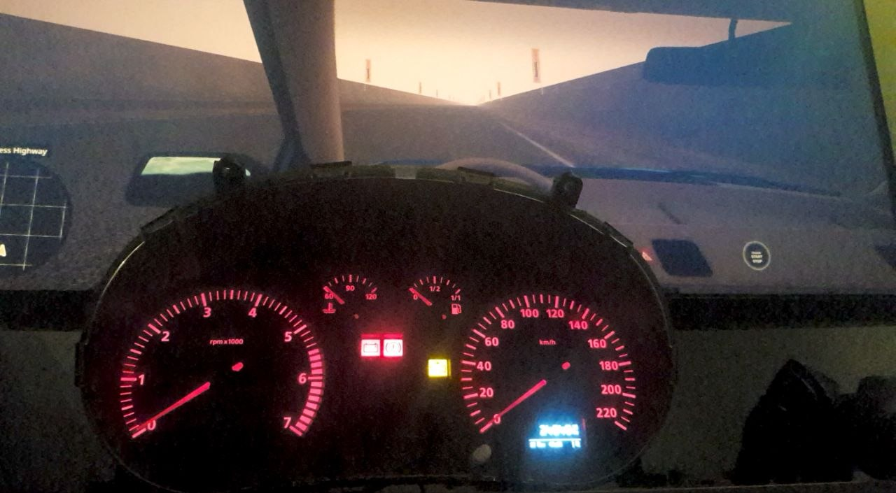
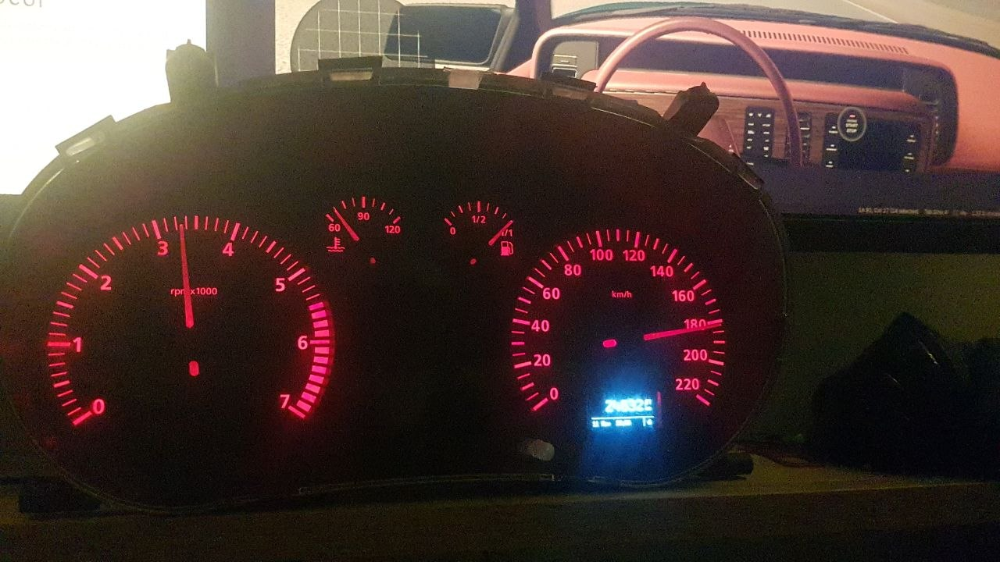
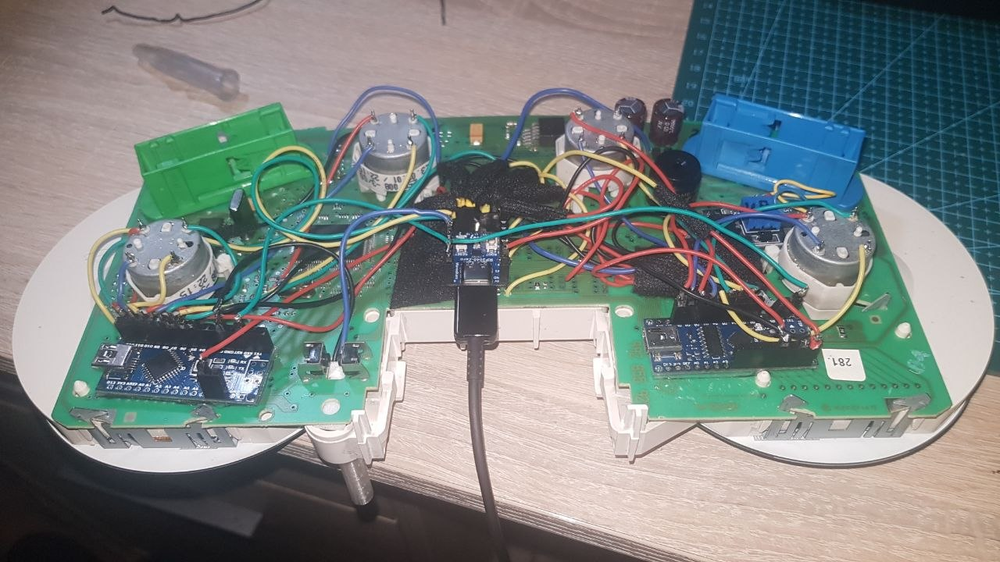
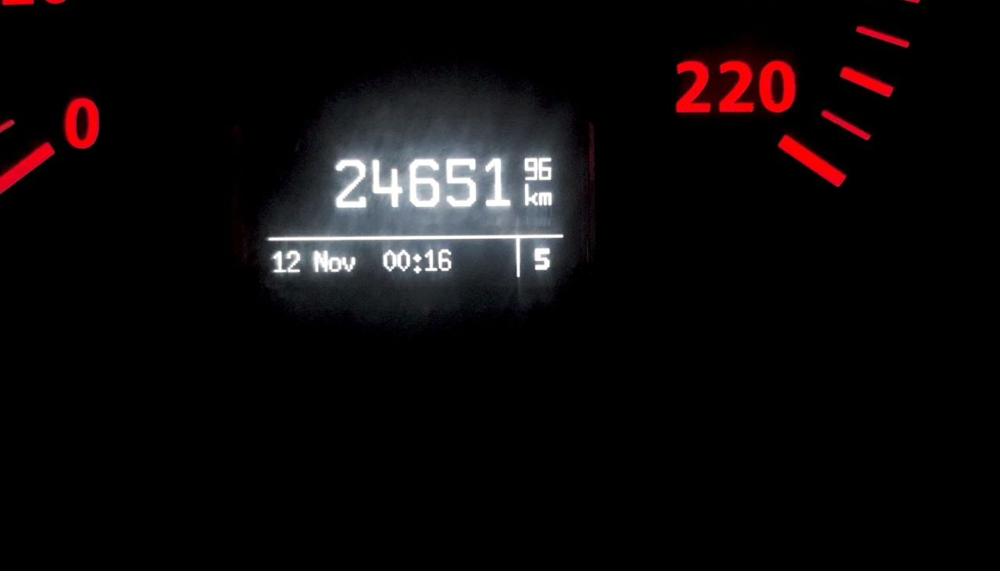
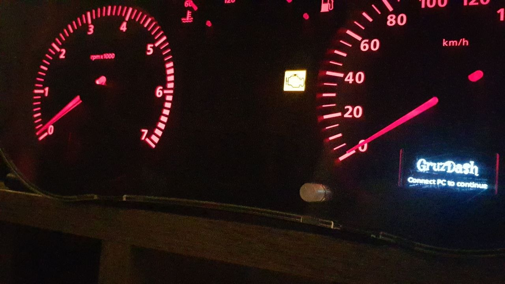

# GruzDash - OutGauge

A funny project that will help you transform old car dashboard into... in-game car dashbboard!





## Features

🛞 No refresh speed limit

🛶 Smooth easings for big needles

🚘 Odometer with mileage stored locally on a computer

🪶 Multi-platform & lightweight

🎮 Supports any OutGauge-compatible game


## Setup

### Mandatory

- **Arduino Nano** for RPM + Coolant Temperature

- Another **Arduino Nano** for Speedo + Fuel

- **RP2040 / esp32** for 'the brain'

- _dual-sided gel tape_


### Optional / Custom

- **SH1107 I2C OLED** as display for mileage and other stuff

- **Button** which triggers changes on OLED display

- **8x 100 Ohm resistors** - for dashboard LEDs

- **Step-up 12V converter** - for backlight


## Connection

### Nanos

Connect each needle motor to Arduinos, using all 4 pins for each motor. Make sure you have pins in proper order: usually it's 1A 1B 2B 2A.

**I strongly advise to use 31kHz PWM outputs!** or else you'll hear annoying buzz sound from each big needle. **Those pins are: 11, 10, 9, 3** (for Arduino Nano, at least), so please use them for big needles.

### The brain

Now, RP2040 / esp32. We need it to fully utilize two cores, as I2C display is pretty slow, so it's offloaded into Core 1.
**While Nanos are used for needle motors only, The brain is used for everything else.**

Connect dashboard LEDs into any digital pin you'd like to. They're triggered by `HIGH` pin state.

**Exception:** as pins deliver 3.3V, **blue LED won't turn on**. To deal with this without additional equipement, I've connected blue LED to 5V, and triggered it with GND (`LOW`). So, blue LED steering is inverted.

Backlight: use step-up converter and turn it on/off via dedicated pin. If your converter has no such pin, simply use bridged NPN-PNP transistors. Backlight is triggered with `HIGH`.

OLED display: connect I2C pins to hardware I2C (preferably I2C0) pins

**Here's the cobweb I've made:**




## Software

For MCUs, I've used Arduino IDE

### Nanos / Needles

Open `driver-needles` folder, you'll find `driver-needles.ino` there.

There's a `config.h` inside, so tweak it to your likings.

**Note**: Please create a seperate file with your tuned configs, as this project must be uploaded to two boards with different gauges.


### The brain

Open `driver-central` folder, you'll find `driver-central.ino` there.

There's a `config.h` inside, so tweak it to your likings.


### Communication

**Right after you program your boards**, connect Nanos' RX pins with TX pin on 'The brain'. Single TX pin sends data to both Nanos at the same time.

While playing a game, **you must connect your computer to RP2040/esp32!**


### outgouge

- a computer program written for this project. **Download it from [Releases](https://github.com/dani3l0/gruz-dash-og/releases)**, or if you don't trust me, compile it yourself:

```
cd bridge
go build .
```

And `outgouge` or `outgouge.exe` will be yielded


## Finishing

Once you have the executable binary file, put it in some newly-created folder. Program will create `config.json` with some editable configuration, such as odometer (yes, you can edit it), OutGauge IP:port or serial device path / COM port.

_Have fun!_

-----


